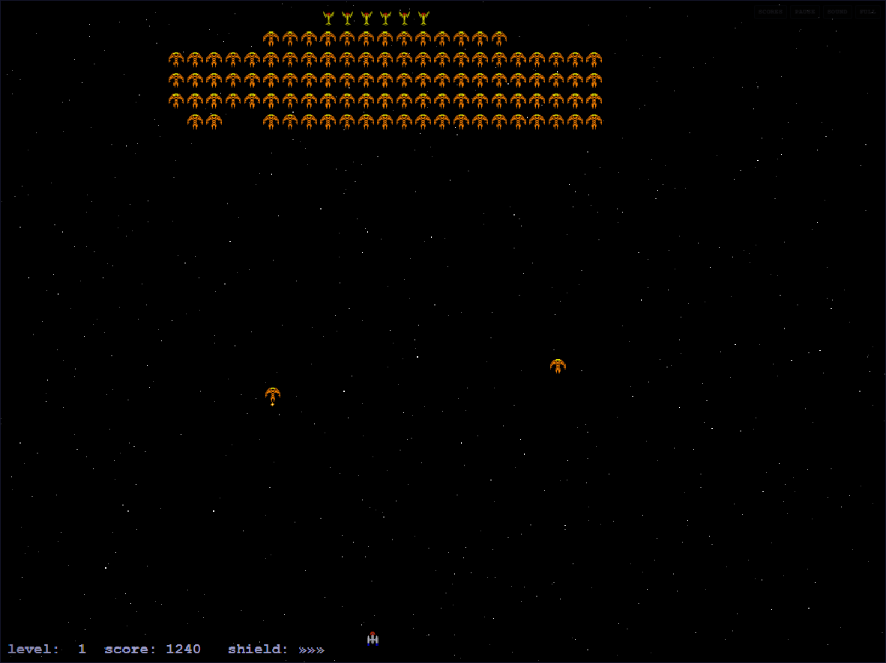

# XGalaga++ · Web Edition

A faithful browser port of [XGalaga++ 0.9](http://marc.mongenet.ch/OSS/XGalaga/),
Marc Mongenet's X11 arcade shooter. The original C++ game has been reimplemented
in plain HTML5 canvas + JavaScript, with the original XPM pixel art embedded
directly in the page. No build step, plugins, or server-side code are required.



## Play

Open `index.html` in any modern browser. That's it.

- **Simplest:** double-click `index.html`.
- **Recommended:** serve the folder over HTTP, for example:

  ```sh
  # from this directory
  npx serve .
  # or
  python3 -m http.server 8000
  ```

  Then visit <http://localhost:8000/>.

Serving over HTTP gives each browser a stable origin for saved high scores and
settings. Direct `file://` play works too, but some browsers restrict or reset
`localStorage` for file URLs.

## Controls

| Action | Keyboard | Pointer / touch |
| --- | --- | --- |
| Start game | `Enter`, `S`, or `Space` | Tap the play field |
| Move | `A` / `D` or `←` / `→` | Drag horizontally |
| Fire | Hold `Space`, `Z`, or `K` | Fire automatically while pointing/dragging |
| Pause / resume | `P` or `Esc` | Pause button, or tap while paused |
| High scores | `H` (menu) | **SCORES** button |
| Mute sound | `M` | **SOUND** button |
| Fullscreen | `F` | **FULL** button |
| Screen size | `1`–`5` | — |
| Star detail | `+` / `-` | — |
| Scanlines / CRT | `V` | — |
| Cheat (during play) | `C` | — |

The original's extra-life-style rules still apply: every 1,000 points adds one
shield, and losing all shields destroys the ship. Qualifying scores are saved
locally with a pilot name of up to 12 characters.

## What is preserved

- **Gameplay simulation.** The engine runs the original fixed 50 Hz logic tick.
  Player physics, bullet and bomb limits, alien convoys, dive paths, formation
  entry, bonus drops, collision order, scoring, shield awards, and the
  13 hand-authored levels are ported directly from the C++ sources.
- **Level data.** All 13 level tables and every trajectory path were compared
  programmatically against `main.cc`; they match exactly.
- **Graphics.** The 21 original XPM sprites (`player`, aliens, bullets, bombs,
  bonus icons) are embedded byte-for-byte and parsed at runtime, so the game
  keeps its authentic 1990s pixel-art look.
- **Screen layout.** 4:3 game field, letterboxed and scaled with nearest-neighbour
  filtering, plus the original scrolling starfield layers and optional scanlines.

## Web-specific additions

- Start/help screen and in-game HUD.
- Top-ten high-score table persisted in `localStorage`.
- Mouse/touch steering with automatic fire.
- Synthesized WebAudio sound effects (no external assets), with mute saved.
- Pause overlay, game-over summary, and a pilot-name entry dialog.
- Adjustable internal resolution (`640×480` to `1600×1200`), detail level,
  scanline toggle, and fullscreen.
- A tiny read-only debug hook: `window.XGALAGA`.

These extras are presentation and convenience layers; the simulation underneath
is the original game.

## Differences from the X11 release

- High scores are a single global top-ten list instead of being split by screen
  size and refresh rate.
- The original's command-line/environment configuration is replaced by in-page
  settings saved in `localStorage`.
- Sound is synthesized in the browser because the original relied on the host's
  X11 bell/system sounds.
- The shield indicator uses the original repeated Latin-1 chevron glyph rather
  than a custom icon, keeping the HUD close to the source.

## Project layout

```
index.html          page shell, canvas, toolbar, score dialog
css/style.css       responsive 4:3 presentation, CRT effect, dialogs
js/xpm-data.js      embedded original XPM artwork (generated)
js/sprites.js       XPM parser and sprite drawing
js/audio.js         WebAudio sound effects
js/engine.js        ported game simulation and all level data
js/game.js          main loop, renderer, menus, input, persistence
COPYING             GNU General Public License v2
```

## Credits and license

- **XGalaga++ 0.9** © 2003–2017 Marc Mongenet.
  <http://marc.mongenet.ch/OSS/XGalaga/>
- **XGalaga 2.0.34 graphics** © 1995, 1998 Joe Rumsey.
- This browser port is distributed under the **GNU General Public License,
  version 2** (see [`COPYING`](COPYING)), matching the original project's GPL
  licensing.

This is an unofficial fan port and is not endorsed by the original authors.
